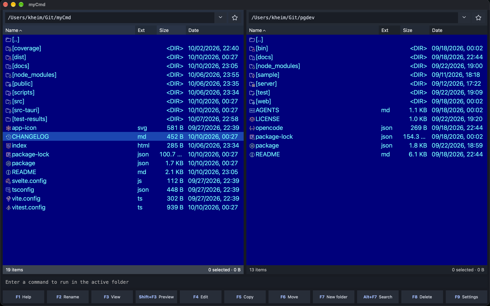

# myCmd


myCmd is a keyboard-centric, two-panel file manager in the Norton / Total Commander tradition: two folder panels side by side, a command line, and every action one function key away. It is a cross-platform desktop app with a Rust backend ([Tauri](https://tauri.app/)) and a [Svelte](https://svelte.dev/) frontend.



## Features

- Two file panels with full keyboard navigation (arrows, Home/End, PageUp/PageDown, Tab to switch, Shift+Tab to swap)
- Copy (F5), Move (F6), Rename (F2), New folder (F7), Delete to Recycle Bin/Trash (F8) or permanently (Shift+F8)
- Copy/cut/paste files between myCmd and other file managers using the system clipboard (Ctrl+C / Ctrl+X / Ctrl+V; Cmd on macOS). Explorer and Linux file-manager cut markers are recognized; Finder receives files as copies.
- Right-click context menus for files and empty panel space, also available with Shift+F10 or the Menu key
- System actions for one local item: the classic Explorer menu and shell extensions in an isolated helper on Windows; native Open With and file-manager reveal actions on Linux; Open With, Reveal in Finder, and Get Info on macOS. macOS may ask for permission to control Finder. Finder extensions, Services, and Linux file-manager extensions are not embedded.
- View files (F3) and a toggleable preview pane (Shift+F3): rendered Markdown (including fenced `mermaid` diagrams), PDF with page navigation and zoom, syntax-highlighted code/text/JSON via Monaco, with search and match navigation
- Search (Alt+F7) by file/folder name glob, optionally by file content (UTF-8/UTF-16, binaries skipped); browse results while the search is still running
- Selection by glob (+/-), invert (\*), quick find by typing, directory-size calculation (Space)
- Browse inside archives and extract from them (F5)
- Compress selected files or folders to ZIP in the opposite panel (Alt+F5), with remembered Fast / Balanced / Smallest compression; symbolic links are skipped
- Built-in command line for the active folder, plus opening a system terminal there (Ctrl+T)
- Drive picker (Alt+F1 / Alt+F2), hidden-files toggle (Ctrl+H), file-list font sizing, resizable columns, Catppuccin file icons
- Settings dialog (F9) and a shortcuts reference (F1)
- File properties (Alt+Enter): copy the full path, calculate folder size, inspect symbolic links, and edit Unix permissions or the Windows read-only attribute without recursive changes

## Install

Download the installer for your platform from [GitHub Releases](https://github.com/pankleks/myCmd/releases): MSI/NSIS for Windows x64, DEB/AppImage for Linux x64, DMG for macOS Apple Silicon.

Packages are currently unsigned. On macOS, after dragging myCmd to Applications, run once:

```sh
xattr -cr /Applications/myCmd.app
codesign --force --deep --sign - /Applications/myCmd.app
```

## Run from source

Requirements: Node.js 22.13+ and a stable Rust toolchain (see [docs/RELEASING.md](docs/RELEASING.md) for OS dependencies).

```sh
npm ci
npm run dev
```

Other useful commands: `npm test`, `npm run build`, `npm run tauri -- build --bundles dmg -- --locked` for a local macOS installer.

**Work in progress — things may not work.**
